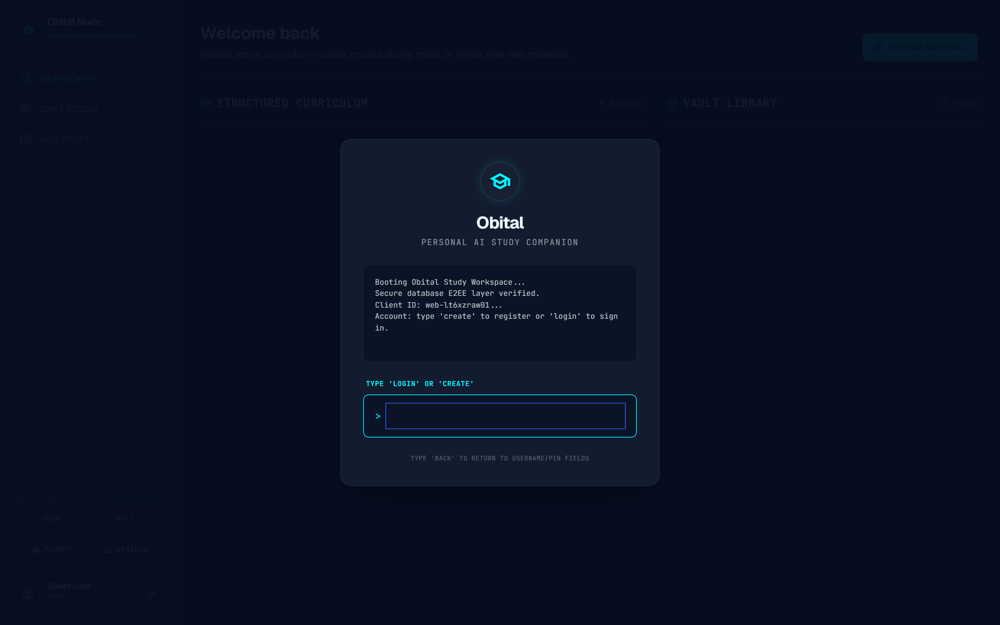
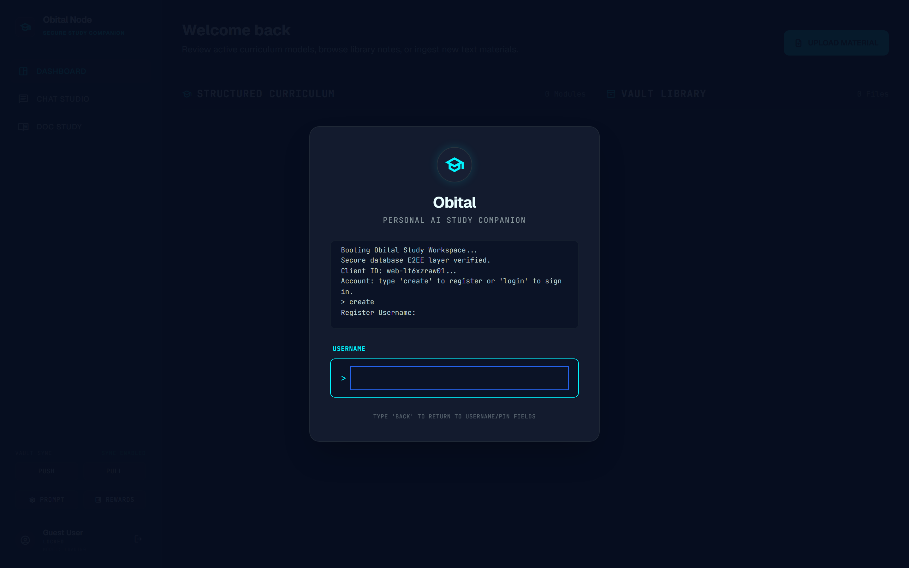
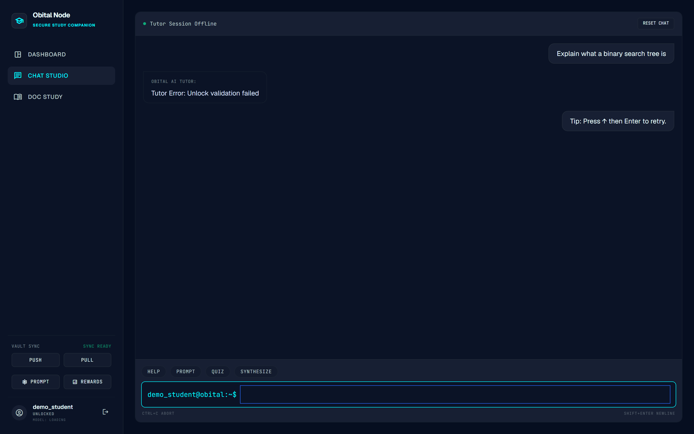
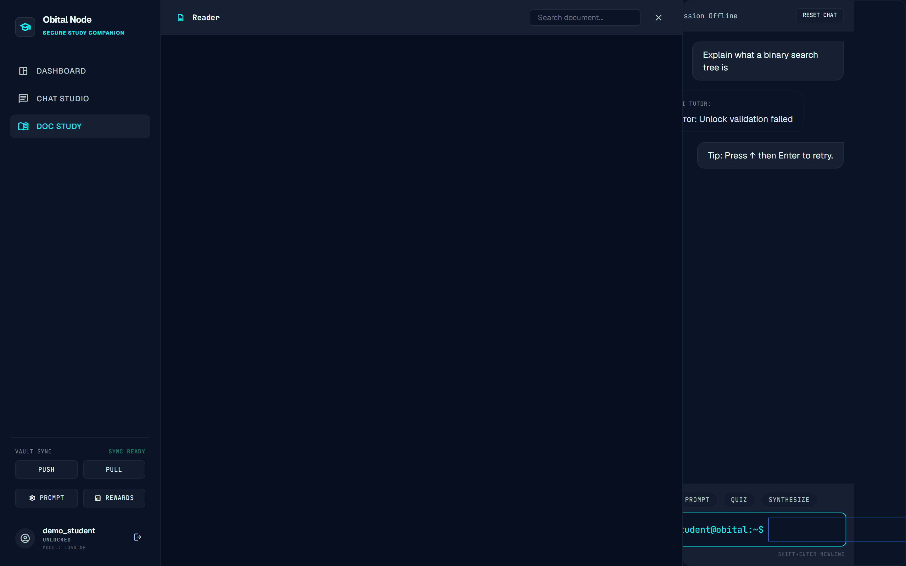
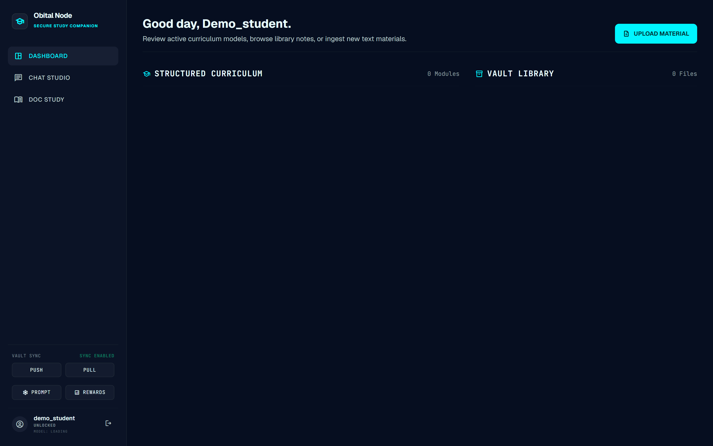
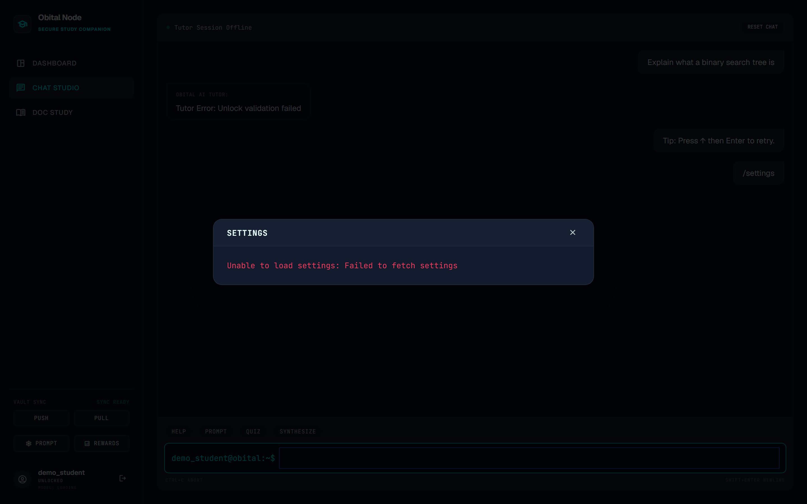

<div align="center">

# 🎓 Obital
### A Gamified, AI-Powered, Privacy-First Personal Study Companion

**Orbital 2026 · Team Obital · Proposed Level of Achievement: Apollo 11**

*"Turning studying from a chore into something you genuinely look forward to."*

`FastAPI` · `Python` · `DeepSeek LLM` · `Supabase / PostgreSQL` · `Sentence-Transformers RAG` · `End-to-End Encryption` · `PWA`

</div>

---

> **About this document.** This is the full product README for **Obital**. It documents the motivation, aim, target users, user stories, the complete feature list (implemented and planned), the milestone-by-milestone scope, the system architecture, the technology stack, installation/testing instructions, the development timeline, and the current implementation status with screenshots of the live web interface. It is intentionally exhaustive so that a new contributor, a grader, or a stakeholder can understand the entire project end-to-end from this single file.

---

## 📑 Table of Contents

1. [Motivation](#1-motivation)
2. [Aim](#2-aim)
3. [Target Users](#3-target-users)
4. [User Stories](#4-user-stories)
5. [Scope of Project](#5-scope-of-project)
6. [Full Feature List](#6-full-feature-list)
7. [Features Aimed to Be Completed](#7-features-aimed-to-be-completed)
8. [Milestone-Specific Feature Scope](#8-milestone-specific-feature-scope)
9. [Current Progress — Features Implemented (1.1–1.7)](#9-current-progress--features-implemented-1117)
10. [Features To Be Implemented (1.8–1.12)](#10-features-to-be-implemented-1812)
11. [System Design & Architecture](#11-system-design--architecture)
12. [Tech Stack](#12-tech-stack)
13. [Installation & Testing Instructions](#13-installation--testing-instructions)
14. [Timeline & Development Plan](#14-timeline--development-plan)
15. [Repository Structure](#15-repository-structure)
16. [Security & Privacy Model](#16-security--privacy-model)
17. [Testing, Quality & CI](#17-testing-quality--ci)
18. [Software Engineering Practices](#18-software-engineering-practices)
19. [Data Sources & Acknowledgements](#19-data-sources--acknowledgements)
20. [Glossary](#20-glossary)
21. [Team & License](#21-team--license)

---

## 1. Motivation

Studying multiple modules, picking up new subjects, or learning to code can be an **isolating and frustrating** experience — especially for beginners who struggle to stay consistent without structure or feedback.

We observed three concrete problems that motivated Obital:

- **Secondary and pre-tertiary students** find it hard to wade through thick piles of textbooks and unstructured notes. The cognitive overhead of *figuring out what to study next* is itself a barrier to studying at all.
- **Computing students** who use existing platforms like LeetCode or Codecademy often find them either **too dry** (walls of text, no momentum) or **too passive** (watch-and-forget), and they fail to build the **habit of daily practice** that actually produces mastery.
- **Casual and lifelong learners** (including working adults and the elderly) want to learn something new, but nothing about traditional study tools makes them *want* to come back tomorrow.

Across all three, the missing ingredient is the same: **motivation and structure**. People don't fail to learn because the material is unavailable — they fail because the experience is joyless, unstructured, and offers no feedback loop.

We want to change that by building a **gamified learning app/browser that makes learning feel rewarding** — turning what can feel like a chore into something users genuinely look forward to. Concretely, that means:

- **Bite-sized, level-based progression** so a beginner is never overwhelmed.
- **Streaks, points, currency, and rewards** so there is always a reason to open the app today.
- **An AI tutor** that explains *why* an answer was wrong in plain language, so users build understanding rather than memorising.
- **Smart resource management** — content is loaded and unloaded on demand so the experience stays fast and light.

Beyond the product itself, this project is our opportunity to develop **real software-engineering discipline**: designing systems that scale, managing a development timeline across milestones, writing tested and reviewed code, and shipping something we are proud of that can genuinely impact many people's lives.

A second, equally important motivation emerged as the project matured into the **Obital** codebase: **privacy**. A study companion accumulates a remarkably intimate record of a person — what they don't understand, what they get wrong, what they're studying and when. We decided early that this data should belong to the user and the user alone. That is why Obital is built around a **client-controlled, end-to-end-encryption (E2EE)** model: the cloud stores ciphertext, and only the user's passphrase can unlock their own data. Privacy is not an afterthought bolted on at the end; it is a load-bearing column of the architecture.

---

## 2. Aim

We aim to build a **web application (and, by extension, a mobile/PWA app)** that teaches multiple subjects — **Science, Mathematics, and Coding** — to **all users**, including secondary students, JC students, polytechnic and university students, working adults, and the elderly. For tertiary learners we also include **programming languages** (e.g. Python from scratch).

The experience is designed to be:

- **Structured enough for complete beginners** — concepts are introduced progressively, one idea at a time, through a level-based curriculum.
- **Engaging enough to keep intermediate learners coming back** — gamification, leaderboards, an in-app economy, and a conversational AI tutor.
- **Intuitive from the first launch** — a clean shell, sensible defaults, and graceful fallbacks so the app is usable even when parts of the backend are offline.

Our goal is an app that **feels intuitive from the first launch and motivating enough that users return daily**, while reducing cognitive overload through smart resource management and respecting user privacy through end-to-end encryption.

**Success, for us, looks like:**

| Dimension | Target |
|---|---|
| **Engagement** | A user who opens the app on day 1 has a reason (streak + points + next level) to open it on day 2, 3, 7. |
| **Learning** | A user who gets a question wrong can ask the AI tutor *why* and come away understanding the concept. |
| **Breadth** | The same engine teaches Math, Science, and Coding by ingesting curated notes for each. |
| **Trust** | A user's study data is encrypted such that even the operators of the cloud cannot read it. |
| **Craft** | The codebase is layered, tested, reviewed, and shipped incrementally across three milestones. |

---

## 3. Target Users

Obital is deliberately broad in audience because the *gamified, bite-sized, AI-assisted* formula generalises across ages and subjects. We designed around five primary personas.

### Persona A — "The Career-Switcher" (Working Adult learning to code)
> *Wei, 29, marketing executive, wants to learn Python to move into a data role.*

- **Needs:** structure, low time commitment per session, and the feeling of fun rather than a second job.
- **Pain today:** tutorials are dry; he loses momentum after a week.
- **How Obital helps:** bite-sized coding levels, daily streaks, and an AI tutor he can ask "why is my code wrong?".

### Persona B — "The Bored Gamer" (Elderly lifelong learner)
> *Mdm Tan, 64, plays Candy Crush daily and wants something more rewarding.*

- **Needs:** a game-like loop that is genuinely fun, plus the satisfaction of learning a brand-new skill.
- **Pain today:** casual games feel hollow; formal courses feel intimidating.
- **How Obital helps:** a Candy-Crush-style level map, points and rewards, plus subjects she's curious about — learning *disguised* as a game.

### Persona C — "The Secondary-School Student" (Math improver)
> *Arjun, 15, struggling with Math, learns best with quick repetition.*

- **Needs:** flashcards and quizzes that drill concepts without a wall of text.
- **How Obital helps:** auto-generated flashcards and quizzes (NotebookLM-style) from curated Math notes, with instant right/wrong feedback.

### Persona D — "The JC Science Student" (A-level syllabus)
> *Mei, 17, needs Physics notes tailored to the Singapore-Cambridge A-level syllabus.*

- **Needs:** curated, syllabus-aligned notes rather than generic internet content.
- **How Obital helps:** a curated content library sourced from quality A-level material, turned into structured, queryable lessons.

### Persona E — "The Beginner Programmer" (Python from scratch) & "The Inconsistent Learner"
> *Sam, 20, wants to build confidence one concept at a time and needs a reason to keep going.*

- **Needs:** one-concept-per-level progression and a streak/reward loop to stay consistent.
- **How Obital helps:** locked/unlocked levels, points, and a visible progress dashboard.

### Cross-cutting persona needs
- **The Visual Learner** — wants an interactive, game-like UI with clear right/wrong feedback instead of walls of text.
- **The Accessibility-First User** — wants text-to-speech so they can learn without staring at a screen.
- **The Intermediate Learner who makes mistakes** — wants an AI assistant that explains *why* an answer was wrong in plain language.

---

## 4. User Stories

These are taken directly from the Orbital proposal and are the backbone of our feature prioritisation. Each is written in the standard *"As a ⟨role⟩, I want ⟨capability⟩, so that ⟨benefit⟩"* form.

| # | User Story | Primary Feature(s) |
|---|---|---|
| **US-1** | As a **working adult who wants to learn coding from scratch**, I want to have fun while learning to code and enjoy the process. | Gamified UI (1.8–1.11), AI Chatbot (1.4) |
| **US-2** | As an **elderly person who loves Candy Crush but is bored of it**, I want to play a game that is *more* fun than Candy Crush while learning a brand-new skill (e.g. Astronomy). | Gamified UI / Levels (1.8–1.11) |
| **US-3** | As a **secondary student who wants to improve in Math**, I want to learn Math easily through **flashcards and quizzes**. | Quiz & Flashcard Generation (1.6) |
| **US-4** | As a **JC student learning Science**, I want to learn Physics easily through **curated notes tailored to the Singapore-Cambridge A-level syllabus**. | Curated AI Notes (1.2) |
| **US-5** | As a **beginner programmer learning Python from scratch**, I want to progress through **bite-sized levels that introduce one concept at a time**, so I can build confidence without feeling overwhelmed. | Curriculum / Levels (1.2, 1.11) |
| **US-6** | As a **casual learner who struggles to stay consistent**, I want a **streak system and point rewards**, so I have a daily reason to open the app and keep my progress alive. | Dashboard / Rewards (1.7), Shop (1.8) |
| **US-7** | As a **visual learner who finds walls of text discouraging**, I want an **interactive, game-like UI with clear feedback** on right and wrong answers, so learning feels engaging rather than tedious. | Gamified UI (1.8–1.11) |
| **US-8** | As a **user with accessibility needs**, I want a **text-to-speech option** that reads out questions and explanations, so I can learn even when I can't stare at a screen. | TTS / Document Scanner (Extension) |
| **US-9** | As an **intermediate learner who makes mistakes**, I want access to an **AI assistant that explains why my answer was wrong in plain language**, so I can actually understand and not just memorise. | AI Chatbot (1.4), Quiz grading (1.6) |

### Acceptance criteria (representative)

To keep the stories testable, each maps to concrete acceptance criteria. A few examples:

- **US-3 (flashcards/quizzes):** Given a topic with curated notes, when the student requests a quiz, the system generates ≥ N questions with answers and grades the student's responses, showing which were correct.
- **US-6 (streaks/points):** Given a student completes a checkpoint, when the result is recorded, their points increase and their streak/last-active date updates and persists across sessions and devices.
- **US-9 (AI tutor):** Given a student answers a quiz question incorrectly, when they ask the chatbot why, the chatbot responds with a plain-language explanation grounded in the relevant notes.

---

## 5. Scope of Project

### In scope (the Orbital 2026 deliverable)

1. A **web-first application** ("Obital") that runs in the browser as a Progressive Web App (PWA), with a path to a mobile build.
2. A **content pipeline** that ingests curated notes/documents (PDF, text, Markdown), builds a retrieval index, and generates a **structured curriculum + question/answer sets** using an LLM.
3. An **AI tutor chatbot** grounded in the user's own materials and the curated library.
4. **Auto-generated quizzes and flashcards** (NotebookLM-style) with local grading and points.
5. A **gamification layer**: points, streaks, leaderboard, in-app currency, a shop, avatars, and social features.
6. A **privacy-preserving cloud**: account-scoped storage with **end-to-end encryption**, plus cross-device sync.
7. **Accessibility**: text-to-speech for questions and explanations.

### Out of scope (explicitly, for this iteration)

- Full multi-tenant SaaS hardening (enterprise SSO, org admin consoles).
- Native iOS/Android apps beyond a Flutter extension/PWA install (the native app is an *extension* goal — see 1.12).
- Human-authored editorial content at scale — we **curate** existing quality sources and transform them, rather than writing a full syllabus ourselves.
- Real-money transactions — the in-app economy uses **in-game currency only**.

### Non-functional scope

| Attribute | Commitment |
|---|---|
| **Performance** | First few levels preloaded; subsequent levels prefetched so progression has no perceptible lag. |
| **Privacy** | User study data encrypted at rest in the cloud with keys the operator never sees. |
| **Reliability** | Graceful degradation — the app remains usable (with reduced features) when the LLM, embedding model, or DB is unavailable. |
| **Portability** | Runs locally (SQLite) for development and in the cloud (PostgreSQL/Supabase) for production, from the same codebase. |
| **Accessibility** | Keyboard-navigable shell; TTS for content; high-contrast dark theme. |

---

## 6. Full Feature List

Obital's features are numbered **1.1 – 1.12**. Features **1.1 – 1.7 are implemented** in the current codebase; features **1.8 – 1.12 are in progress / planned**. This section lists every feature; Sections 9 and 10 go deep on each with screenshots and status.

### Core & current features (implemented)

| Ref | Feature | One-line description | Status |
|---|---|---|---|
| **1.1** | **Authentication** | Account creation + login with PIN, and a passphrase-derived encryption vault (E2EE). | ✅ Implemented |
| **1.2** | **Curated AI Notes** | A curated study-content library (sourced from quality A-level / coding material) ingested into structured, queryable lessons. | ✅ Implemented (content ingestion + curriculum) |
| **1.3** | **Supabase Database + Contribute** | PostgreSQL (Supabase) cloud storage with a *Contribute* flow that pushes a user's own materials to *their own* account vault. | ✅ Implemented |
| **1.4** | **AI Chatbot (DeepSeek)** | A conversational AI tutor grounded in the user's notes, powered by the DeepSeek LLM with tool-calling. | ✅ Implemented |
| **1.5** | **PDF & Photo Parser** | Upload documents (PDF / text / images); text is extracted, chunked, and embedded for retrieval and study. | ✅ Implemented (PDF/text; image OCR roadmap) |
| **1.6** | **Quiz & Flashcard Generation** | NotebookLM-style automatic generation of quizzes and flashcards from notes, with grading. | ✅ Implemented |
| **1.7** | **Profile / Dashboard** | A study dashboard (progress, quiz stats, rewards) with **Night Mode** and an **FAQ** page. | ✅ Implemented |

### Extension & planned features (in progress)

| Ref | Feature | One-line description | Status |
|---|---|---|---|
| **1.8** | **Shop & Fortnite-style Skins** | Spend in-game currency on cosmetic items / skins. | 🚧 In progress |
| **1.9** | **Avatar Customisation** | Personalise a learner avatar. | 🚧 In progress |
| **1.10** | **Socials / Friends** | Add friends, see who's online, and join their study sessions; leaderboard integration. | 🚧 In progress |
| **1.11** | **Gamified Game Mode** | Co-op "Focus Raids" (Pomodoro) + RAG-powered "Trivia Arenas". | 🚧 In progress |
| **1.12** | **Mobile App** | A Flutter-based mobile extension of the web app. | 🚧 In progress |

### Supporting / infrastructure features (cross-cutting)

These are not numbered in the proposal but are real, implemented capabilities that the numbered features depend on:

- **End-to-End Encryption (E2EE) vault** — Argon2id-derived key encrypts all user content (see §16).
- **Cross-device cloud sync** — push/pull of a user's encrypted vault between local and cloud.
- **Retrieval-Augmented Generation (RAG) pipeline** — chunking + sentence-transformer embeddings + similarity retrieval feeding the LLM.
- **Curriculum & QA generation pipeline** (`engine`) — the offline engine that turns documents into lessons and questions.
- **Usage metering & account limits** — token/document/lesson quotas per account.
- **Graceful degradation** — hash-embedding fallback when the model is absent; "local mode" replies when the LLM key is absent.

---

## 7. Features Aimed to Be Completed

By the end of the Orbital timeline (Milestone 3), we aim to have **all twelve features (1.1–1.12) functional**, composing into the full gamified, privacy-first study companion. Concretely, the features we are *targeting to complete* beyond the current implementation are:

1. **1.8 Shop & Skins** — an in-game store where leaderboard rank yields currency to spend on cosmetic skins.
2. **1.9 Avatar Customisation** — a customisable learner avatar tied to the profile.
3. **1.10 Socials** — friend lists, online presence, session invites, and leaderboard rivalry.
4. **1.11 Gamified Game Mode** — the headline gamification: a Candy-Crush/Clash-Royale-style **level map**, **co-op Focus Raids** (shared Pomodoro study sessions), and **RAG-powered Trivia Arenas** (live quiz battles drawing questions from the curated corpus).
5. **1.12 Mobile App** — a **Flutter** extension so users can study on their phones while travelling or away from a laptop, with offline caching of core content.

Additionally, we aim to complete the **extension features** described in the original proposal:

- **Text-to-Speech (TTS)** via the Web Speech API, reading questions and explanations aloud (US-8, accessibility).
- **PWA installability** on Android and iOS directly from the browser, with offline caching.
- **Real-time cloud sync** of all progress, streaks, currency, and shop purchases across devices.

The **stretch / "nice-to-have"** items we will attempt if time permits:

- Image **OCR** to extend the document parser (1.5) from PDFs/text to photographed notes.
- A **leaderboard** with seasonal resets and rewards.
- A **new-user onboarding flow** and PWA install prompt for first-time users (final polish).

---

## 8. Milestone-Specific Feature Scope

The project is delivered in three milestones. The scope below reflects the proposal's plan, annotated with the **actual implementation** as it stands in the Obital codebase (the implemented stack evolved from the original proposal — see §12 for the reconciliation).

### Milestone 1 — Technical Proof of Concept (by end of Week 4)
**Goal:** demonstrate that the core architecture works end-to-end with a minimal feature slice.

| Feature | Planned scope | Status |
|---|---|---|
| **Feature 1 — Cloud Database** | Cloud SQL database set up; ≥ 5 sample levels and associated notes/topics stored and retrievable via a REST API (FastAPI). | ✅ Done (PostgreSQL/Supabase + SQLite local; FastAPI REST API) |
| **Feature 2 — Gamified UI** | Basic UI renders a level map with ≥ 3 tappable levels; core game logic; basic points. | 🟡 Partial (web shell + dashboard; gamified level map is roadmap 1.11) |
| **Feature 3 — Game Tabs** | Points stored locally and incremented on level completion; daily study tracker scaffolded. | ✅ Done (points/streak/rewards service + dashboard) |
| **Feature 4 — Login & Sign-in** | Login/Sign-in completed, connected to the database with hashed passwords, session management, parameterised queries, and input validation. | ✅ Done (PIN auth + E2EE passphrase vault; see §16) |
| **Feature 5 — AI Chatbot** | Functional chatbot answering queries with basic responses; initial DB integration for content retrieval. | ✅ Done (DeepSeek chatbot + RAG retrieval) |

### Milestone 2 — Prototype (by end of Week 8)
**Goal:** a working web app with all core features functional and testable.

| Feature | Planned scope | Status |
|---|---|---|
| **Feature 1 (complete)** | Dynamic loading/unloading of levels via REST API; next levels prefetched with no perceptible lag. | ✅ Backend complete (account-scoped lesson/doc loading) |
| **Feature 2 (complete)** | Full level-map UI with animations, locking/unlocking, in-level question flow; **leaderboard**; **in-game currency** tied to rank; **shop** scaffolded. | 🚧 In progress (quiz flow done; level map / leaderboard / shop = 1.8–1.11) |
| **Feature 3 (complete)** | Streak tracking, points display, full progress dashboard; metrics synced to cloud and persisted across sessions. | ✅ Done (rewards dashboard + sync) |
| **Feature 4 (done)** | Authentication stable and fully tested; protected routes; cross-device progress sync. | ✅ Done (auth tests + cloud sync) |
| **Feature 5 (done)** | Refined chatbot fully integrated for **topic-aware** responses; embedded as a persistent widget. | ✅ Done (RAG-grounded chat embedded in Chat Studio + Doc Study) |

### Milestone 3 — Extended System (by end of Week 12)
**Goal:** a polished, production-ready PWA with extension features and full mobile support.

| Feature | Planned scope | Status |
|---|---|---|
| **Feature 6 — Document Scanner + TTS** | Web Speech API TTS for questions/documentation; deep integration with the AI chatbot so it gives robust, context-aware responses informed by scanned documents. | 🚧 Planned (document parser done; TTS = roadmap) |
| **Feature 7 — App version** | PWA fully configured (service worker + manifest); installable on Android/iOS with offline caching; desktop experience preserved. | 🚧 In progress (1.12 Flutter / PWA) |
| **Cloud Sync (complete)** | All progress, streaks, currency, and purchases persisted and synced in real time across devices. | ✅ Core done (encrypted push/pull); currency/purchases pending 1.8 |
| **Final Polish (complete)** | Bug fixes, onboarding flow, mobile-responsive pass, PWA install prompt. | 🚧 Planned |

---

## 9. Current Progress — Features Implemented (1.1–1.7)

This section documents what is **working today** in the Obital codebase, with screenshots captured from the live web interface (the "Obital Node" Secure Study Companion shell). 

> **About the screenshots.** These were captured by booting the actual FastAPI backend locally (SQLite mode) and driving the real web UI with a headless browser, using a freshly created demo account (`demo_student`). Where a panel shows an "offline" or error state, it is because the demo capture ran **without a `DEEPSEEK_API_KEY`, without the embedding model installed, and in local SQLite mode** — the *interface* is real and live; only the external AI services were intentionally not configured for the capture. Captions note this where relevant.

### 1.1 — Authentication 🔐 ✅

A terminal-styled, privacy-first authentication flow. On boot, the app verifies the secure E2EE database layer and prompts the user to `create` an account or `login`. Account creation collects a **username**, a **PIN (4–12 digits)**, and a **passphrase ("Vault Key")** that derives the encryption key for all of the user's content.

**What's implemented:**
- Account registration and login (`/auth/register`, `/auth/login`) backed by a salted, iterated PIN hash (PBKDF2-HMAC-SHA256) with constant-time verification.
- A passphrase-derived **Argon2id** key-encryption-key (KEK) that wraps a per-account **data-encryption-key (DEK)** — the foundation of the E2EE vault (see §16).
- **Unlock sessions** with a bearer token (stored hashed), a TTL, client binding, and exponential-backoff lockout after repeated failures.
- Input validation on account IDs, PIN length, and client identity headers.


*Figure 1.1a — The Obital boot/login overlay. The terminal confirms "Secure database E2EE layer verified" and prompts the user to type `create` or `login`.*


*Figure 1.1b — The account-creation flow (username → PIN → confirm PIN → passphrase vault key).*

---

### 1.2 — Curated AI Notes 📚 ✅

A curated study-content library that turns quality source material (A-level notes, coding references) into **structured, queryable lessons**. Rather than authoring a syllabus by hand, Obital **ingests curated sources** (see §19 for provenance) and runs them through the `engine` pipeline to produce a structured curriculum of topics, objectives, content blocks, and checkpoints.

**What's implemented:**
- A document-ingestion pipeline (`engine/pipeline`) that extracts text, chunks it, embeds it (sentence-transformers `all-MiniLM-L6-v2`), and builds a retrieval index.
- An LLM-backed **curriculum generator** and **QA generator** that turn the indexed corpus into lessons and question sets (`/pipeline/generate-curriculum`, `/pipeline/generate-topic-qa`).
- Account-scoped **lessons** persisted and retrievable via `/lessons`, with checkpoints and progress tracking.
- The Dashboard surfaces the curated curriculum as **"Structured Curriculum"** modules and the user's materials as the **"Vault Library."**

*The Dashboard (Figure 1.7) shows the "Structured Curriculum — N Modules" and "Vault Library — N Files" panels that present curated notes once a curriculum is generated for the account.*

> **Status note:** the ingestion → curriculum → lessons pipeline is implemented and tested. Bulk-loading the full curated note corpus (projectjc / Holy Grail sources) is an ongoing content-population task rather than an engineering gap.

---

### 1.3 — Supabase Database + Contribute Page 🗄️ ✅

Obital uses **PostgreSQL (hosted on Supabase)** as its cloud database, with **SQLite** for local development — both driven from the same code via a single configuration switch. A **Contribute** flow lets a user push their *own* materials and progress to *their own* account-scoped vault in the cloud.

**What's implemented:**
- A storage layer (`backend/app/services/storage.py`, `db.py`) that works against either SQLite (local) or PostgreSQL (Supabase) with **Alembic** migrations.
- **Account-scoped, end-to-end-encrypted** storage: each user's documents, chat sessions, rewards, and settings are isolated per `account_id` and encrypted with that account's DEK.
- A **cloud sync** service (`account_sync.py`, `sync_scheduler.py`) exposing **Push** and **Pull** so a user can contribute/retrieve their encrypted vault across devices (`/sync/push`, `/sync/pull`).
- The web shell exposes **Vault Sync → PUSH / PULL** controls and a live "Sync Enabled / Sync Ready" status.

*The Dashboard sidebar (Figure 1.7) shows the **Vault Sync** panel with **PUSH** and **PULL** controls and a "SYNC ENABLED" indicator — this is the Contribute flow that persists a user's vault to Supabase.*

---

### 1.4 — AI Chatbot (DeepSeek) 🤖 ✅

A conversational AI **tutor** — "Chat Studio" — that answers questions about the user's topics, grounded in their notes via retrieval-augmented generation. It is powered by the **DeepSeek** LLM through an OpenAI-compatible client, with **tool-calling** so the model can start quizzes, continue lessons, search documents, and adjust settings.

**What's implemented:**
- A streaming chat engine (`chat_engine.py`, `chat_service.py`) with **Server-Sent Events (SSE)** token streaming to the UI.
- **RAG grounding:** relevant chunks from the user's documents are retrieved (semantic embeddings + similarity) and injected into the prompt.
- **Tool-calling:** the tutor can invoke quiz generation, lesson continuation, document search, and settings updates (`chat_tools.py`).
- **Careful streaming hygiene:** internal tool-markup is stripped from the stream so raw model control tokens never leak to the UI.
- **Graceful fallback:** if no `DEEPSEEK_API_KEY` is configured, the tutor returns a clear "model unavailable" message instead of crashing — visible in the capture below.
- A **Quiz / Synthesize / Prompt / Help** command bar and a slash-command terminal (`/help`, `/quiz`, `/lesson continue`, `/docs`, `/sync push`, …).


*Figure 1.4 — The Chat Studio interface. The user asked "Explain what a binary search tree is." In this demo capture the tutor reports "offline" because no `DEEPSEEK_API_KEY` was configured and the local-mode unlock token wasn't validated (a known SQLite-mode datetime issue); with a key configured and in cloud mode, the tutor streams a grounded answer here. Note the `HELP / PROMPT / QUIZ / SYNTHESIZE` command bar and the `demo_student@obital:~$` terminal input.*

---

### 1.5 — PDF & Photo Parser 📄 ✅

A document ingestion + reading feature — "Doc Study" — that lets users **upload documents** (PDF, text, Markdown), extracts and chunks the text, embeds it for retrieval, and presents a side-by-side **Reader + Chat** view so the tutor can answer questions about the open document.

**What's implemented:**
- **Document upload** (`/docs/upload`) with text extraction via `pypdf` for PDFs and native readers for text/Markdown.
- **Chunking + embedding** of uploaded content, stored encrypted and searchable (`/docs/search`, `/docs/search/text`).
- A **Reader** pane with in-document search and a docked chat workspace, so a user can read a note and ask the tutor about it in the same view.
- **Vector search** with an embedding-dimension-validated query API.


*Figure 1.5 — The "Doc Study" Reader. The left pane is the document reader with a "Search document…" box; the right pane docks the AI tutor so questions can be asked about the open document. (Empty in this capture as the demo account has no uploaded files yet.)*

> **Status note:** PDF, text, and Markdown parsing are implemented. **Photo/Image OCR** (parsing photographed notes) is on the roadmap as an extension of this feature.

---

### 1.6 — Quiz & Flashcard Generation 📝 ✅

NotebookLM-style **automatic generation of quizzes and flashcards** from the user's notes, with local grading and points. The tutor (or the `/quiz` command, or the Quiz button) generates a set of questions for a topic or lesson checkpoint, the user answers them, and the system grades the responses and awards points.

**What's implemented:**
- A **QA-generation pipeline** (`engine/quiz`, `quiz_service.py`) that produces multiple-choice and short-answer questions from the curated/embedded content.
- **Quiz build & grade** endpoints (`/quiz/build`, `/quiz/grade`) and an in-chat quiz flow with MCQ and text grading (including fuzzy/lexical matching and cosine-similarity scoring).
- **Checkpoint quizzes** tied to lessons, so passing a checkpoint advances the user's curriculum progress.
- **Rewards integration:** quiz results feed points, accuracy, and the rewards dashboard.

*The Chat Studio command bar (Figure 1.4) includes a **QUIZ** action; the `/quiz` slash command and lesson checkpoints also trigger generation. Generated quizzes render inline in the chat as an interactive question flow.*

---

### 1.7 — Profile / Dashboard 📊 ✅

A study **Dashboard** that greets the user, surfaces their curated curriculum and vault library, and provides quick access to sync, rewards, and settings — including **Night Mode** (the app ships a dark theme by default) and an **FAQ**.

**What's implemented:**
- A **Dashboard** (`/rewards/dashboard`) showing the user greeting, **Structured Curriculum** module count, **Vault Library** file count, and an **Upload Material** action.
- A **Rewards** view: total points, quizzes taken, quiz accuracy, and a score-trend chart (`RewardsDashboardResponse`).
- **Settings** (`/settings`): a configurable chat system prompt, plus the dark/Night-Mode theme and FAQ.
- A persistent **account status** footer (signed-in user, vault unlocked/locked state, model status) and **Vault Sync** controls.


*Figure 1.7 — The Dashboard after signing in as `demo_student`: greeting, "Structured Curriculum" and "Vault Library" panels, "Upload Material" action, the **Vault Sync (Push/Pull)**, **Prompt**, and **Rewards** controls, and the account/unlock-status footer. The entire UI uses the dark Night-Mode theme by default.*


*Figure 1.7b — The Settings modal (opened via `/settings`). It hosts the chat system-prompt configuration and app preferences. (Shows a "failed to fetch settings" state in this demo capture due to the local-mode unlock-token issue noted in §17; the modal and its controls are live.)*

---

### Implementation status summary (1.1–1.7)

| Ref | Feature | Backend | Web UI | Notes |
|---|---|:---:|:---:|---|
| 1.1 | Authentication | ✅ | ✅ | PIN + E2EE passphrase vault, unlock sessions, lockout |
| 1.2 | Curated AI Notes | ✅ | ✅ | Pipeline + lessons live; corpus population ongoing |
| 1.3 | Supabase + Contribute | ✅ | ✅ | Postgres/SQLite + encrypted push/pull sync |
| 1.4 | AI Chatbot (DeepSeek) | ✅ | ✅ | SSE streaming, RAG grounding, tool-calling |
| 1.5 | PDF & Photo Parser | ✅ | ✅ | PDF/text/MD done; image OCR roadmap |
| 1.6 | Quiz & Flashcard Gen | ✅ | ✅ | MCQ + short-answer, grading, rewards |
| 1.7 | Profile / Dashboard | ✅ | ✅ | Dashboard, rewards, settings, Night Mode, FAQ |

---

## 10. Features To Be Implemented (1.8–1.12)

These features are **in progress / planned** and constitute the gamification and mobile-extension layer that elevates Obital from a study tool to a genuinely game-like experience. They are the focus of the remaining milestones.

### 1.8 — Shop & Fortnite-style Skins 🛍️ 🚧
- **Goal:** an in-app **shop** where users spend **in-game currency** (earned via leaderboard rank and consistency) on cosmetic items and **skins**.
- **Plan:** a `shop` service + endpoints for the item catalogue, purchases, and an inventory; currency ledger tied to rewards/rank; a Shop tab in the web shell.
- **Depends on:** rewards/currency (1.7 ✅) and leaderboard (part of 1.10).

### 1.9 — Avatar Customisation 🧑‍🎨 🚧
- **Goal:** a customisable **learner avatar** that reflects purchased skins/items and appears on the profile and leaderboard.
- **Plan:** an avatar configuration stored per account (encrypted like other vault data), an avatar editor UI, and rendering across profile/social surfaces.
- **Depends on:** Shop (1.8) for cosmetic items.

### 1.10 — Socials / Friends 👥 🚧
- **Goal:** add friends, see **online presence**, invite friends into a **study session**, and compete on a **leaderboard**.
- **Plan:** a friends/relationship model, presence tracking, session invites, and a ranked leaderboard with seasonal resets and rewards.
- **Note:** this introduces genuinely multi-user data flows; it will be built on top of the authenticated, account-bound model (see §16 — strengthening server-side authorization is a prerequisite).

### 1.11 — Gamified Game Mode 🎮 🚧
The **headline gamification** that realises User Stories US-1, US-2, US-5, and US-7:
- **Candy-Crush / Clash-Royale-style level map** — bite-sized, locked/unlocked levels with animations and clear right/wrong feedback.
- **Co-op Focus Raids** — shared **Pomodoro** study sessions where friends study together against a timer/goal.
- **RAG-powered Trivia Arenas** — live quiz battles whose questions are drawn from the curated corpus via the existing RAG pipeline (1.2/1.6 ✅).
- **Plan:** a game-state engine, real-time session coordination, and a rich animated front-end; reuses the curriculum (1.2), quiz generation (1.6), and rewards (1.7) already in place.

### 1.12 — Mobile App (Flutter Extension) 📱 🚧
- **Goal:** extend the browser app to a **Flutter** mobile app so users can study on phones while travelling or away from a laptop.
- **Plan:** a Flutter client consuming the same FastAPI backend, with offline caching of core content; the desktop/browser PWA experience preserved and optimised separately.
- **Interim:** PWA installability (service worker + manifest) provides a mobile-installable experience ahead of the full Flutter build.

### Planned cross-cutting (Milestone 3)
- **Text-to-Speech (TTS)** — Web Speech API reads questions and explanations aloud (US-8 accessibility).
- **PWA install + offline caching** — installable on Android/iOS, offline study of cached core content.
- **Onboarding + final polish** — first-run onboarding, mobile-responsive pass, PWA install prompt.

---

## 11. System Design & Architecture

Obital follows a **layered architecture** with a strict separation of concerns: a content pipeline (source of truth), a backend adapter (API + services), and clients (web/TUI/mobile). This makes the system testable, swappable, and scalable.

### 11.1 High-level architecture

```
┌──────────────────────────────────────────────────────────────────────────┐
│                              CLIENTS (presentation)                         │
│                                                                            │
│   Web App (PWA)            Textual TUI (dev)        Flutter App (planned)   │
│   "Obital Node" shell      terminal client          mobile (1.12)          │
│   Dashboard · Chat ·                                                       │
│   Doc Study · Settings                                                     │
└───────────────┬────────────────────────────────────────────────────────────┘
                │  HTTPS / REST + Server-Sent Events (SSE)
                ▼
┌──────────────────────────────────────────────────────────────────────────┐
│                       BACKEND — FastAPI (application layer)                 │
│                                                                            │
│  API ROUTERS (backend/app/api):                                            │
│    auth · chat · doc · lesson · quiz · pipeline · rewards ·                 │
│    settings · sync · usage                                                 │
│                                                                            │
│  SERVICES (backend/app/services):                                          │
│    chat_engine · chat_tools · chat_service   (AI tutor + tool-calling)     │
│    storage · db · models                     (persistence, SQLite/PG)      │
│    embeddings                                (vector embeddings + fallback)│
│    crypto_local · unlock_session · unlock_guard  (E2EE + auth)             │
│    account_sync · sync_scheduler             (cross-device cloud sync)      │
│    usage · settings_service · quiz_service                                 │
└───────────────┬───────────────────────────────────────┬───────────────────┘
                │ imports (source of truth)              │
                ▼                                         ▼
┌─────────────────────────────────────────┐   ┌──────────────────────────────┐
│   engine  (content pipeline)  │   │   DATA & EXTERNAL SERVICES     │
│                                          │   │                                │
│   pipeline/ : extract → chunk → embed →  │   │   PostgreSQL (Supabase) / SQLite│
│               RAG → curriculum/QA (LLM)  │   │   DeepSeek LLM API             │
│   quiz/     : quiz backend, intent       │   │   sentence-transformers model  │
│               router, account system     │   │   Vercel (hosting)             │
│   shared/   : account paths, context     │   │                                │
└─────────────────────────────────────────┘   └──────────────────────────────┘
```

### 11.2 Layered responsibilities

| Layer | Responsibility | Key modules |
|---|---|---|
| **Presentation** | Render the study experience; stream chat; collect input. | `backend/app/templates/index.html` (web), `frontend/` (React source + Textual TUI) |
| **Application (API)** | HTTP routing, request validation, response shaping, SSE streaming. | `backend/app/api/*` |
| **Domain (Services)** | Business logic: tutoring, quizzes, storage, crypto, sync, metering. | `backend/app/services/*` |
| **Pipeline (Source of truth)** | Turn documents into curriculum, questions, and a retrieval index. | `engine/*` |
| **Data** | Persist encrypted, account-scoped state. | SQLite / PostgreSQL via SQLAlchemy + Alembic |
| **External** | LLM inference, embeddings, hosting. | DeepSeek API, sentence-transformers, Vercel |

### 11.3 Request lifecycle — "ask the AI tutor a question"

1. The web client sends `POST /chat/sessions/{id}/messages` with the user's message, the `account_id`, and the unlock token / client-id headers.
2. The **chat API router** validates input and resolves the account's data-encryption key from the unlock session.
3. **`chat_service`** persists the user message (encrypted) and assembles recent history.
4. **`chat_engine`** retrieves relevant chunks from the user's documents (**RAG**: embed the query → similarity search → top-K chunks) and builds a grounded prompt.
5. The engine calls **DeepSeek** with **tool definitions**; the model may call tools (start a quiz, continue a lesson, search docs).
6. Tokens stream back via **SSE**; tool-markup is stripped so only clean text reaches the UI.
7. The assistant reply is persisted (encrypted), usage is metered, and the stream terminates with a `done` event.

### 11.4 Content pipeline lifecycle — "turn notes into a course"

```
 curated notes (PDF/TXT/MD)
        │  extract_text
        ▼
   raw text  ──chunk──▶  chunks  ──embed (MiniLM)──▶  vector index
                                                          │
                                          retrieval / similarity
                                                          ▼
                          LLM (DeepSeek)  ──▶  Curriculum (topics, objectives,
                                                checkpoints)
                                          ──▶  QA sets (questions + answers)
                                                          │
                                                          ▼
                                   account-scoped lessons + quizzes (encrypted)
```

### 11.5 Data model (core entities)

| Entity | Purpose |
|---|---|
| **Account / AccountKey** | User identity; Argon2 params, salt, wrapped DEK, unlock version, lockout state. |
| **AccountUnlockSession** | Active vault session: hashed token, encrypted DEK, TTL, client binding. |
| **Lesson / Checkpoint** | A curated topic with objectives, content blocks, and pass-threshold checkpoints. |
| **Doc / DocChunk** | An uploaded document and its embedded, searchable chunks. |
| **ChatSession / ChatMessage** | Encrypted conversation history, optionally tied to a lesson/document. |
| **Reward / RewardSession / RewardEvent** | Points, accuracy, streak, and a per-session reward log. |
| **AccountArtifact** | Generic encrypted, account-scoped artifact (settings, QA, curriculum). |
| **AccountUsage** | Token/document/lesson/storage counters and limits. |

### 11.6 Key design decisions

- **Pipeline as source of truth.** The backend is an *adapter* over account-scoped pipeline artifacts; this keeps the heavy ML/LLM logic decoupled from the web layer.
- **Same code, two databases.** A single switch runs SQLite locally and PostgreSQL/Supabase in the cloud, so development is frictionless and production is robust.
- **E2EE by construction.** Encryption is applied in the service layer on the write path, so persistence backends only ever see ciphertext for user content.
- **Graceful degradation everywhere.** Missing model → deterministic hash embeddings; missing LLM key → local-mode replies; read-only filesystem (serverless) → detected and tolerated.
- **Streaming-first chat.** SSE keeps the tutor responsive and the UI live, with a holdback buffer that prevents tool-control tokens from leaking.

---

## 12. Tech Stack

> **Note on stack evolution.** The original Orbital proposal planned Azure SQL, Firebase Auth, and the Gemini API. As the project matured into the **Obital** codebase, the team adopted **Supabase/PostgreSQL**, a **custom end-to-end-encryption auth model**, and the **DeepSeek** LLM. The table below documents the **actually-implemented** stack; the proposal's original choices are noted for historical context.

### 12.1 Frontend

| Technology | Role |
|---|---|
| **HTML5 + Vanilla JS + Tailwind (CDN)** | The shipped **"Obital Node"** web shell (Chat Studio, Dashboard, Doc Study, Settings) — a single-page app served by FastAPI. |
| **React + TypeScript + Vite** | A component-based frontend (`frontend/src`) maintained alongside the shell for the richer gamified UI to come. |
| **Textual (Python TUI)** | A terminal client (`frontend/`) used in development and for the engine CLI flow. |
| **marked + KaTeX** | Markdown + math rendering in chat/notes. |
| **Service Worker + Web Manifest** *(planned)* | PWA installability + offline caching (Milestone 3). |
| **Flutter** *(planned, 1.12)* | Native mobile app extension. |

### 12.2 Backend

| Technology | Role |
|---|---|
| **Python 3.13+** | Primary language. |
| **FastAPI** | REST API + SSE streaming; 10 routers, ~43 routes. |
| **Uvicorn** | ASGI server. |
| **SQLAlchemy 2.x + Alembic** | ORM + schema migrations. |
| **Pydantic 2.x** | Request/response validation and schemas. |

### 12.3 AI / ML

| Technology | Role |
|---|---|
| **DeepSeek LLM** (OpenAI-compatible client) | The AI tutor, curriculum generation, and QA generation. |
| **sentence-transformers (`all-MiniLM-L6-v2`)** | Text embeddings for retrieval (RAG), with a deterministic hash fallback. |
| **Retrieval-Augmented Generation (RAG)** | Grounds the tutor and quizzes in the user's own notes. |

### 12.4 Database & Persistence

| Technology | Role |
|---|---|
| **PostgreSQL (Supabase)** | Production cloud database (account-scoped, encrypted). |
| **SQLite** | Local-development database (same code path). |
| **psycopg 3** | PostgreSQL driver. |

### 12.5 Security / Crypto

| Technology | Role |
|---|---|
| **Argon2id (argon2-cffi)** | Passphrase → key-encryption-key (KEK) derivation. |
| **AES-GCM (cryptography)** | Authenticated encryption of user content (DEK). |
| **Fernet** | Encrypts the session DEK at rest. |
| **PBKDF2-HMAC-SHA256** | PIN hashing with per-user salt + constant-time compare. |

### 12.6 Hosting & DevOps

| Technology | Role |
|---|---|
| **Vercel** | Web hosting / serverless deployment (`api/index.py`, `vercel.json`). |
| **GitHub Actions** | CI: hash-verified dependency installs + `pip-audit` security auditing. |
| **pip-tools (`pip-compile --generate-hashes`)** | Hash-pinned, reproducible dependency locks. |

### 12.7 Users (audience tiers)

| Tier | Who | Primary features |
|---|---|---|
| **Learners** | Students (secondary/JC/poly/uni), working adults, elderly | All study features (1.1–1.12) |
| **Contributors** | Learners who upload their own notes | Contribute/Upload (1.3, 1.5) |
| **Operators** | The team / deployment owner | Cloud DB, sync scheduler, metering, CI |

### 12.8 Proposal-vs-implementation reconciliation

| Concern | Proposal plan | Implemented |
|---|---|---|
| Database | Azure SQL | **Supabase / PostgreSQL** (+ SQLite local) |
| Auth | Firebase Auth (JWT) | **Custom PIN + Argon2/AES-GCM E2EE vault** |
| LLM | Gemini API | **DeepSeek API** |
| Frontend | React | **Vanilla-JS PWA shell** (shipped) + React source + Textual TUI |
| Cloud sync | Firebase Realtime DB | **Custom encrypted push/pull sync** over PostgreSQL |
| Hosting | Firebase Hosting | **Vercel** |

---

## 13. Installation & Testing Instructions

The instructions below are **verified** — they reflect the exact steps used to boot the app and run the test suite during development on a clean machine (Windows 11, Python 3.14).

### 13.1 Prerequisites

- **Python 3.13+** (3.14 works).
- **git**.
- *(Optional)* A **DeepSeek API key** for live AI tutoring/generation.
- *(Optional)* **PostgreSQL / Supabase** connection string for cloud mode (SQLite is used otherwise).

### 13.2 Clone & set up a virtual environment

```powershell
git clone https://github.com/Asdao/Obital.git
cd Obital

# Create and activate a virtual environment
python -m venv .venv
.\.venv\Scripts\Activate.ps1      # Windows PowerShell
# source .venv/bin/activate       # macOS/Linux

# Install dependencies (root requirements covers the backend runtime)
python -m pip install --upgrade pip
python -m pip install -r requirements.txt
```

> **Dependency note:** the backend imports `openai`, `sentence-transformers`, `pypdf`, and `python-dotenv`. The root `requirements.txt` includes the runtime essentials. To enable real semantic embeddings, also install the model deps: `pip install sentence-transformers torch`. Without them, the app automatically falls back to deterministic hash embeddings (reduced search quality, but fully functional).

### 13.3 Configure environment

Copy the example env file and fill in values:

```powershell
copy .env.example .env
```

Key variables (see `.env.example` for the full list):

| Variable | Purpose | Local default |
|---|---|---|
| `DEEPSEEK_API_KEY` | DeepSeek LLM key (chat + generation). | *(unset → local-mode replies)* |
| `DEEPSEEK_MODEL` | Model id. | `deepseek-v4-flash` |
| `LOCAL_DATABASE_URL` | SQLite local DB (enables DB mode). | `sqlite:///backend/data/obital.db` |
| `DATABASE_URL` | PostgreSQL/Supabase (cloud mode). | *(unset for local)* |
| `UNLOCK_TOKEN_SECRET` | Secret for unlock-session tokens. | set any non-empty value |

### 13.4 Run the backend (web app)

```powershell
# Helper script (Windows): boots backend, waits for /health, launches the TUI
.\scripts\dev\run_obital.ps1

# Or run the API directly:
$env:PYTHONPATH = (Get-Location)
python -m uvicorn backend.app.main:app --host 127.0.0.1 --port 8000
```

Then open **http://127.0.0.1:8000/** for the web shell, or **http://127.0.0.1:8000/api/docs** for the interactive API docs.

**Health checks:**

```powershell
curl http://127.0.0.1:8000/health       # → {"status":"ok"}
curl http://127.0.0.1:8000/health/db    # → DB connectivity status
```

### 13.5 Run the test suite

The maintained evidence groups are deterministic and do not call a live LLM:

```powershell
$env:PYTHONPATH = (Get-Location)

# Unit evidence (43 cases)
python -m pytest engine/tests/test_quiz_modes.py engine/tests/test_checkpoint_normalization.py backend/tests/test_auth_api.py backend/tests/test_stateless_storage.py -q

# API/integration evidence (31 cases)
python -m pytest backend/tests/test_sync_api.py backend/tests/test_workspace_api.py backend/tests/test_stream_and_routes.py -q

# Browser-runtime evidence (40 Chromium cases)
pip install -r backend/tests/requirements-test.in
python -m playwright install chromium
python -m pytest backend/tests/test_browser_js.py -q

# Historical full suites (useful for debt triage; may include known legacy failures)
python -m pytest backend/tests/ -q
python -m pytest engine/tests/ -q
```

See [`TESTING.md`](../testing/TESTING.md) for named cases, expected assertions, verified counts, regression mapping, and honest browser/UI coverage boundaries.

### 13.6 Verified smoke test (chatbot end-to-end)

A minimal end-to-end check of the AI chat pipeline (works without an API key via the local-mode fallback):

```python
from fastapi.testclient import TestClient
from backend.app.main import app
c = TestClient(app)

print(c.get("/health").json())                                   # {'status':'ok'}
sid = c.post("/chat/sessions", params={"account_id":"admin"}, json={}).json()["session_id"]
r = c.post(f"/chat/sessions/{sid}/messages", params={"account_id":"admin"},
           json={"message":"What is a binary tree?"})
print(r.status_code, r.json()["reply"][:80])                     # 200, a tutor reply (or local-mode fallback)
print(len(c.get(f"/chat/sessions/{sid}", params={"account_id":"admin"}).json()["messages"]))  # 2 (persisted)
```

### 13.7 Cloud (Supabase) mode

Set `DATABASE_URL` to your Supabase PostgreSQL connection string and run Alembic migrations:

```powershell
$env:DATABASE_URL = "postgresql+psycopg://<user>:<pass>@<host>:5432/<db>"
python -m alembic -c backend/alembic.ini upgrade head
python -m uvicorn backend.app.main:app --port 8000
```

### 13.8 Build the React frontend (optional)

```powershell
.\scripts\dev\build_frontend.ps1   # runs npm install + vite build for frontend/
```

---

## 14. Timeline & Development Plan

The project is delivered across three Orbital milestones. (Feature scope per milestone is detailed in §8; this section gives the narrative plan and the engineering cadence.)

### Milestone 1 — Technical Proof of Concept *(Week 4)*
**Theme: "prove the architecture end-to-end."**

- Stand up the cloud database and a FastAPI REST backend with ≥ 5 sample levels/notes.
- Ship the **authentication** flow (now an E2EE PIN + passphrase vault).
- Get a **basic AI chatbot** answering queries with initial content retrieval.
- Scaffold the **points/streak** game-state and a minimal UI.
- **Engineering focus:** establish the layered architecture, the SQLite↔Postgres switch, and the crypto envelope early so later features build on a stable base.

### Milestone 2 — Prototype *(Week 8)*
**Theme: "all core features functional and testable."**

- Dynamic, account-scoped **loading/unloading of lessons** via the REST API.
- A refined, **topic-aware chatbot** embedded as a persistent widget (Chat Studio / Doc Study).
- A full **rewards dashboard** (streaks, points, accuracy, trend) synced to the cloud.
- **Quiz & flashcard generation** with grading wired into rewards.
- Begin the **gamified level-map / leaderboard / shop** scaffolding (1.8–1.11).
- **Engineering focus:** test coverage for crypto/sync/chat; cross-device sync; CI hardening.

### Milestone 3 — Extended System *(Week 12)*
**Theme: "prove the connected product is reliable."**

- Stabilise the source → Chat → Lesson → Quiz → reward/Shop journey.
- Clarify onboarding, PIN/passkey responsibilities, and Docs versus Lessons.
- Run maintained unit, API/integration, Chromium, and production-build checks in CI.
- Execute manual system missions across Chrome, Edge, Firefox, Safari, Windows, macOS, and representative mobile viewports.
- Conduct uncoached user testing and record findings, remediation, and retest status in [`docs/testing/MS3_USER_TESTING.md`](../testing/MS3_USER_TESTING.md).
- Apply regression tests for reusable invariants found through exploratory testing.
- Defer native app development, TTS, and additional game modes until the core release gates pass.

### Development cadence
- **Feature branches → pull requests → peer review → merge** (see §18).
- **Incremental, testable slices** each milestone to catch integration issues early.
- **Continuous dependency-security auditing** in CI.

---

## 15. Repository Structure

```
Obital/
├── backend/                        # FastAPI backend (the adapter layer)
│   ├── app/
│   │   ├── main.py                 # App factory: routers, CORS, lifespan, root UI
│   │   ├── schemas.py              # Pydantic request/response models
│   │   ├── api/                    # Routers: auth, chat, doc, lesson, quiz,
│   │   │                           #   pipeline, rewards, settings, sync, usage
│   │   ├── services/               # Domain logic: chat_engine, chat_tools,
│   │   │                           #   storage, db, embeddings, crypto_local,
│   │   │                           #   unlock_session/guard, account_sync,
│   │   │                           #   sync_scheduler, usage, quiz_service, ...
│   │   └── templates/index.html    # The shipped "Obital Node" web shell
│   ├── alembic/                    # Database migrations
│   └── tests/                      # Hermetic backend test suite
│
├── engine/              # The content pipeline (source of truth)
│   ├── pipeline/                   # extract → chunk → embed → RAG → curriculum/QA
│   ├── quiz/                       # quiz backend, intent router, account system
│   ├── shared/                     # account paths, context builder
│   └── tests/                      # Pipeline + quiz tests
│
├── frontend/                       # React/TS source + Textual TUI client
│   ├── src/                        # React components, stores, hooks, api client
│   ├── app.py, ui/                 # Textual TUI
│   └── ...
│
├── api/index.py                    # Vercel serverless entrypoint (exposes `app`)
├── docs/screenshots/               # Screenshots used in this README
├── run_*.ps1                       # Local run/build helper scripts
├── requirements.txt                # Backend runtime dependencies
├── vercel.json                     # Vercel deployment config
├── README.md                       # Pipeline-focused README
├── PRODUCT_GUIDE.md                # ← this document
├── ARCHITECTURE.md / SECURITY.md / CHANGELOG.md
└── CODE_REVIEW.md / REVIEW_SUMMARY.md   # Engineering review artifacts
```

---

## 16. Security & Privacy Model

Privacy is a first-class design goal (see §1). Obital implements a **client-controlled end-to-end-encryption (E2EE)** model.

### 16.1 The encryption envelope

```
passphrase ──Argon2id(salt, params)──▶ KEK (key-encryption key)
                                          │ wraps
random DEK (data-encryption key) ◀────────┘
DEK ──AES-GCM(random nonce)──▶ ciphertext  (enc:v1: prefix, integrity-checked)
```

- The **passphrase never leaves the unlock flow**; it derives a KEK via **Argon2id** (memory-hard).
- The KEK **wraps a per-account DEK**; the DEK encrypts all user content with **AES-GCM** (authenticated, per-message random nonce).
- The cloud stores **ciphertext only** for user content; operators cannot read it without the user's passphrase.
- Decryption **verifies a SHA-256 integrity hash**, so tampered ciphertext is rejected.

### 16.2 Authentication & sessions

- **PIN accounts:** salted **PBKDF2-HMAC-SHA256** with constant-time comparison.
- **Unlock sessions:** a bearer token stored **only as a SHA-256 hash**, with a TTL, client binding (client-id / user-agent), and **exponential-backoff lockout** after repeated failed unlocks.
- **Unlock versioning:** locking the vault invalidates outstanding tokens.

### 16.3 Honest security notes (transparency)

We document known limitations openly (and track them in `docs/reviews/CODE_REVIEW.md`):

- **Account scoping is currently client-asserted on most routes** (the `account_id` is supplied by the client and the unlock token is optional on several read paths). This is acceptable for single-user/local use, but **server-side authorization that binds every request to the unlock-token's account is a prerequisite for the multi-user social features (1.10)** and is on the hardening roadmap.
- **CORS** is controlled via the `CORS_ORIGINS` env var and defaults to same-origin only.
- These items are **acknowledged, tracked, and scheduled** — see `docs/reviews/CODE_REVIEW.md` (§5) and `docs/reviews/REVIEW_SUMMARY.md` for the full prioritised list.

---

## 17. Testing, Quality & CI

### 17.1 Test suite
- **Executable evidence:** [`TESTING.md`](../testing/TESTING.md) links named tests to their source files, inputs, and expected assertions.
- **Maintained unit baseline:** 43 cases covering quiz modes/grading, checkpoint normalization, auth/unlock validation, and storage invariants.
- **Maintained API/integration baseline:** 31 cases covering sync authorization/lockout, encrypted workspace persistence, streaming/API routes, and request validation.
- **Maintained browser baseline:** 40 Playwright cases in real headless Chromium — 37 JavaScript grading/vector cases and 3 live-app pipeline orchestration cases with mocked API responses.
- **Production check:** TypeScript compilation and the Vite production build run in the same GitHub Actions workflow.

These maintained groups are deliberately separated from historical baseline debt. We do not claim that every legacy test passes: some older cases target removed/deprecated symbols or platform-specific path behavior. Stable evidence groups make new regressions visible instead of hiding them inside unrelated failures.

### 17.2 Regression testing

Every reusable defect is represented by a named invariant where practical. Current examples include:

- `test_os_error_is_reported_as_retryable_resource_error` — prevents raw `OSError` leakage in Chat.
- `test_unlock_invalidates_when_version_changes` — prevents stale unlock sessions.
- `test_account_store_preserves_encrypted_progress_on_wrong_dek` — prevents encrypted progress overwrite.
- `test_delete_doc_invalidates_cached_document` — prevents deleted Docs reappearing from cache.
- `test_lesson_grade_rejects_negative_checkpoint_index` — prevents grading/mutating the wrong checkpoint.
- Chromium pipeline failure tests — prevent downstream save after generation failure.

Frontend fixes without a React component harness require TypeScript compilation, a production build, the relevant Chromium runtime checks, and a manual test mission. This limitation is stated explicitly rather than presenting browser logic tests as full E2E UI coverage.

### 17.3 Continuous Integration
- [`.github/workflows/quality-tests.yml`](../../.github/workflows/quality-tests.yml) runs 74 maintained unit/integration cases, 40 Chromium cases, and the frontend production build on pull requests.
- Existing workflows continue to enforce hash-verified dependency installs, license policy, author attribution, and vulnerability audits.
- The root README exposes the **Core Quality CI** badge so test execution is visible from GitHub.

### 17.4 Manual system and MS3 user testing

Automated tests cannot prove that onboarding is understandable, a control does not visually jump, Chat feels responsive on an office laptop, or encrypted sync works between two physical devices.

- [`docs/testing/MANUAL_SYSTEM_TESTS.md`](../testing/MANUAL_SYSTEM_TESTS.md) defines reproducible release missions and a browser/OS/device matrix.
- [`docs/testing/MS3_USER_TESTING.md`](../testing/MS3_USER_TESTING.md) records external session **UT-01**, including authentication confusion, 6/10 Chat freezes, 3/10 `OSError` responses, raw Markdown, hidden Profile, Friends hover movement, and missing paused focus time.
- Each observation is mapped to a product response and an honest retest state. Fixes remain **pending verification** until a tester executes the corresponding release mission.

The MS3 test strategy therefore combines automated regression checks with uncoached exploratory testing and “try to break it” missions across Chrome, Edge, Firefox, Safari, Windows, macOS, and representative mobile viewports.

### 17.5 Engineering review artifacts

- [`docs/reviews/CODE_REVIEW.md`](../reviews/CODE_REVIEW.md) and its follow-ups record prioritized engineering risk and design debt.
- [`docs/reviews/REVIEW_SUMMARY.md`](../reviews/REVIEW_SUMMARY.md) records triage and historical integration observations.
- Review identifies risks; automated and manual tests provide repeatable evidence for selected behavior.

---

## 18. Software Engineering Practices

Per the proposal, we apply the following practices throughout development:

1. **Object-Oriented Design** — well-defined classes (e.g. `Lesson`, `Question`, `UserProgress`, `AccountStore`) keep logic modular and reusable.
2. **Separation of Concerns** — a layered architecture (presentation → API → services → pipeline → data) keeps the codebase testable and extensible (§11).
3. **Version Control with Git** — feature branches, pull requests, and clear commit conventions keep history clean and parallel work manageable.
4. **Incremental Development & Milestones** — each milestone delivers a **testable slice**, catching integration issues early rather than at the end.
5. **Code Reviews** — each member reviews the other's PRs before merging to catch bugs, enforce consistency, and share knowledge. *(This repo also includes an in-depth automated code review — see §17.4.)*
6. **Continuous learning** — team members review each other's evolving coding skills and style across the project.

Additional practices realised in the codebase:
- **Schema migrations** (Alembic) for safe database evolution.
- **Dependency pinning with hashes** (pip-tools) for reproducible, auditable builds.
- **Graceful degradation** and defensive error handling as a design norm.
- **Hermetic tests** so the suite runs anywhere without secrets or network.

---

## 19. Data Sources & Acknowledgements

Obital **curates** existing quality study material and transforms it into structured, queryable lessons (Feature 1.2). The curated note sources include:

- **projectjc** — `https://projectjc.com/` (JC/A-level study material).
- **Holy Grail** — Holy Grail Drive, Website, and Backend (curated notes corpus).

The quiz/flashcard generation approach (Feature 1.6) is **NotebookLM-style** and was informed by:

- **notebooklm-py** — `https://github.com/teng-lin/notebooklm-py.git`.

Open-source technologies we build on include FastAPI, SQLAlchemy, Pydantic, sentence-transformers, the `cryptography` and `argon2-cffi` libraries, Textual, React, Vite, and Tailwind CSS. AI inference is provided by **DeepSeek**.

> All curated third-party content is used in accordance with its respective terms; Obital stores each user's materials encrypted and account-scoped.

---

## 20. Glossary

| Term | Meaning |
|---|---|
| **E2EE** | End-to-End Encryption — data is encrypted such that only the user (via passphrase) can decrypt it. |
| **KEK / DEK** | Key-Encryption-Key (derived from passphrase) / Data-Encryption-Key (encrypts content). |
| **RAG** | Retrieval-Augmented Generation — grounding the LLM in retrieved, relevant content. |
| **Checkpoint** | A graded milestone within a lesson; passing it advances curriculum progress. |
| **Vault** | A user's encrypted, account-scoped store of documents, chats, lessons, and rewards. |
| **Contribute / Sync** | Pushing/pulling a user's encrypted vault between local and cloud. |
| **SSE** | Server-Sent Events — the streaming transport for live chat tokens. |
| **PWA** | Progressive Web App — an installable, offline-capable web app. |
| **`engine`** | The offline content pipeline that is the source of truth for lessons and quizzes. |

---

## 21. Team & License

**Team Obital — Orbital 2026 (Apollo 11).**

This project was built as our Orbital 2026 submission and as a vehicle for developing real software-engineering discipline: layered design, testing, code review, incremental milestone delivery, and shipping a privacy-first product we're proud of.

For engineering details and the current improvement backlog, see **`docs/reviews/CODE_REVIEW.md`** and **`docs/reviews/REVIEW_SUMMARY.md`**. For architecture and security deep-dives, see **`docs/architecture/ARCHITECTURE.md`** and **`SECURITY.md`**.

---

<div align="center">

*Obital — learn something new today, and want to come back tomorrow.* 🚀

</div>
